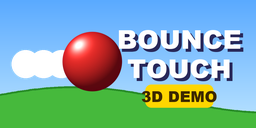
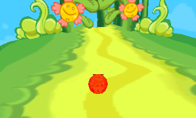
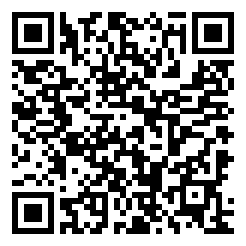

<p align="center"></p>

# Bounce Touch 3D for Nintendo 3DS (unofficial fan port)

**3DS port by alexroses47.** A native port of **Bounce Touch** (Symbian S60v5, 2009) to the Nintendo 3DS,
rebuilt in C++ (libctru + citro3d) from the behaviour of the original game, in the spirit of Ship of
Harkinian, re3 or OpenGOAL. *[Versión en español más abajo](#español).*

> ⚠️ **EXPERIMENTAL — DEMO — PROOF OF CONCEPT.** This is not a finished game. It demonstrates that a Symbian
> game can be ported natively to the 3DS by rebuilding its behaviour with evidence from the original binary.
> Expect bugs, missing parts and frequent changes.
>
> Unofficial and non-commercial. **Not made or endorsed by Rovio or Nokia.** Bounce and Bounce Touch are
> trademarks of their owners. This repository contains **no game data and no game code**: you need your own
> copy of the game.

<p align="center">
   
</p>

<p align="center"><a href="https://alexroses47.github.io/Bounce-Touch-3D/"></a></p>

**Progress:** [alexroses47.github.io/Bounce-Touch-3D](https://alexroses47.github.io/Bounce-Touch-3D/) — game
features done / partial / to do, and every engine rule with the evidence behind it.

## Install (FBI)

1. Open **FBI → Remote Install → Scan QR Code** and scan:

   

   Or download `Bounce-Touch-3D.cia` / `.3dsx` from the [latest release](../../releases/latest).

2. **Put the data of your own copy on the SD card.** The `.cia` contains nothing from the original game.
   On your computer, convert your `Bounce Touch v1.00(57).sis` (requirements under *Building*):

   ```sh
   python3 tools/convert_assets.py "Bounce Touch v1.00(57).sis" bounce-touch-3d
   ```

   and copy the `bounce-touch-3d` folder to `/3ds/bounce-touch-3d/` on the SD card (it must contain
   `scenes/`, `tex/`…). If the data is missing, the game says so on the bottom screen.

## What works in this demo

- **Level 1 playable** with the original's physics, camera and touch controls, checked frame by frame
  against traces of the original game.
- **Touch controls like the original**: swipe to push the ball, hold still on the left/right third of the
  screen to turn the camera, hold in the middle to brake, tap to jump.
- **Camera like the original**: springs, automatic heading, idle close-up, cutscene guides.
- **All 8 levels load and run their scripts**; **stereoscopic 3D at 60 FPS**.
- **Missing**: animations, texts and menus, HUD, audio, save data, the other ball forms and level-specific
  objects. See the [progress page](https://alexroses47.github.io/Bounce-Touch-3D/).

## Screenshots

*Taken from the Azahar emulator with data converted from an own copy (one eye of the 3D image). The
repository does not contain that data.*

<p align="center">
   
</p>

## Controls

| Input | Action |
|---|---|
| Touch screen: swipe | Push the ball in the swipe direction |
| Touch screen: hold still left / right | Turn the camera |
| Touch screen: hold still in the middle | Brake |
| Touch screen: tap, or A / B | Jump |
| Circle Pad / D-pad | The original's key controls |
| L / R | Previous / next level |
| SELECT | Screenshot to the SD card |
| START | Quit |

## Want to help?

So far the project has been built with automated tools (emulation, traces, comparators) and a lot of
patience. To take it from demo to complete game **we want to build a team of people**: C++ and 3DS
programming (citro3d), ARM/Symbian reverse engineering, testing on real hardware, and anyone who still has
the original game and can record reference playthroughs. Open an *issue* or a *discussion* here.

The generic Symbian tools of this project live on in **[RunbIan](https://github.com/alexroses47/RunbIan)**,
a research runtime for native ports of Symbian games.

## Building

Requirements: [devkitPro](https://devkitpro.org) with `3ds-dev` (citro3d, tex3ds), Python 3 and `oggenc`
(`brew install vorbis-tools`). For the `.cia`: `makerom` (Project_CTR) and `bannertool`.

```sh
BOUNCE_SIS="/path/to/Bounce Touch v1.00(57).sis" port/build.sh   # converts your copy into port/romfs, builds port/bounce.3dsx
BOUNCE_3DS_IP=x.x.x.x port/build.sh send                          # 3dslink (press Y in the Homebrew Launcher); the log comes back
MAKEROM=... BANNERTOOL=... port/build.sh release                  # .cia and .3dsx WITHOUT game data
```

Host build and tests (macOS): `port/host/build.sh`, `zsh tests/run_all.sh`, `zsh tests/azahar_smoke.sh`.

## Method

1. **Formats** of the `.sis`, the E32 executables and the KA3D `.hgr` models: [`docs/HGR.md`](docs/HGR.md),
   [`docs/ROMFS.md`](docs/ROMFS.md).
2. **Class map** from the executable's RTTI: [`docs/CLASES.md`](docs/CLASES.md).
3. **Differential bench** (Unicorn): runs original functions and compares them with the port's.
4. **Traces of the original** in the EKA2L1 emulator: ball, collisions, inputs and camera per frame. The
   **host build** replays the same inputs and `tools/compare_traces.py` reports where and by how much the port
   diverges — the regression test for every change.
5. **Rule**: no engine rule without evidence from the binary or a trace; anything unverifiable is marked as
   pending in [`docs/GUIONES.md`](docs/GUIONES.md).

## License

[GPL-3.0](LICENSE). The icon, banner and banner sound are original (`tools/make_icon.py`).

---

## Español

**Port para 3DS por alexroses47.** Port nativo de **Bounce Touch** (Symbian S60v5, 2009) para Nintendo 3DS,
reconstruido en C++ (libctru + citro3d) a partir del comportamiento del juego original, al estilo de Ship of
Harkinian, re3 u OpenGOAL.

> ⚠️ **EXPERIMENTAL — DEMO — PRUEBA DE CONCEPTO.** No es un juego terminado: demuestra que un juego de
> Symbian se puede portar de forma nativa a la 3DS reconstruyendo su comportamiento con evidencia del binario
> original. Espera fallos, partes sin hacer y cambios frecuentes.
>
> No oficial y sin fines de lucro. **No está hecho ni respaldado por Rovio ni Nokia.** Este repositorio **no
> contiene datos ni código del juego**: necesitas tu propia copia.

- **Progreso:** [alexroses47.github.io/Bounce-Touch-3D](https://alexroses47.github.io/Bounce-Touch-3D/):
  funciones hechas, parciales y pendientes, y cada regla del motor con su evidencia.
- **Instalar:** FBI → Remote Install → Scan QR Code y escanea el código de arriba (o descarga el `.cia` de
  [Releases](../../releases/latest)). Después convierte tu `Bounce Touch v1.00(57).sis` con
  `python3 tools/convert_assets.py "Bounce Touch v1.00(57).sis" bounce-touch-3d` y copia la carpeta a la SD en
  `/3ds/bounce-touch-3d/`. Si faltan los datos, el juego te lo dice en la pantalla de abajo.
- **Qué funciona:** el nivel 1 se juega con la física, la cámara y el control táctil del original (comprobados
  fotograma a fotograma contra trazas del juego original); los 8 niveles cargan y ejecutan sus guiones; 3D
  estereoscópico a 60 FPS.
- **Controles:** deslizar empuja la bola; mantener el dedo quieto a la izquierda o la derecha gira la cámara y
  en el centro frena; tocar (o A/B) salta; Circle Pad y cruceta para el control por teclas; L/R cambian de nivel.
- **Qué falta:** animaciones, textos y menús, marcador, audio, guardado, las otras formas de la bola y objetos
  propios de cada nivel.
- **¿Quieres apoyar?** Hasta ahora se ha hecho con herramientas automatizadas (emulación, trazas,
  comparadores) y mucha paciencia. Para pasar de demo a juego completo **buscamos formar un equipo de
  personas**: programación en C++ y 3DS, ingeniería inversa de ARM/Symbian, pruebas en consola real y quien
  conserve el juego original y pueda grabar partidas de referencia. Abre un *issue* o una *discussion*.
- **Herramientas de Symbian:** las genéricas siguen en **[RunbIan](https://github.com/alexroses47/RunbIan)**.
- **Compilar:** devkitPro con `3ds-dev`, Python 3 y `oggenc`; `port/build.sh` convierte tu copia y compila;
  `port/build.sh release` genera el `.cia` y el `.3dsx` sin datos del juego.
- **Licencia:** GPL-3.0. El icono, el banner y su sonido son propios.
