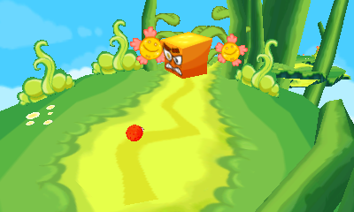
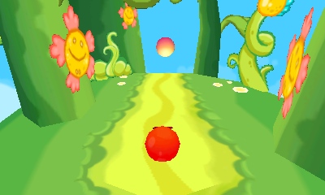
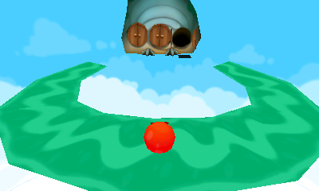

<p align="center"></p>

# Bounce Touch 3D

> ⚠️ **EXPERIMENTAL — DEMO — PRUEBA DE CONCEPTO.** Esto no es un juego terminado: es una demostración de que
> un juego de Symbian se puede portar de forma nativa a Nintendo 3DS reconstruyendo su comportamiento con
> evidencia del binario original. Espera fallos, partes sin hacer y cambios frecuentes.

Port nativo para Nintendo 3DS de **Bounce Touch** (Symbian S60v5, 2009), al estilo de Ship of Harkinian,
re3 u OpenGOAL.

**Qué funciona en esta demo:** el nivel 1 se juega en la consola con la física, la cámara y el control táctil
del original (verificados fotograma a fotograma contra el juego original); los 8 niveles cargan y ejecutan
sus guiones; 3D estereoscópico a 60 FPS.
**Qué falta:** animaciones, textos y menús, audio, guardado, el resto de formas de la bola y objetos de cada
nivel. Estado detallado: [`docs/GUIONES.md`](docs/GUIONES.md) y [`MAPA.md`](MAPA.md).

*Experimental native Nintendo 3DS port of Bounce Touch (Symbian, 2009) — a proof of concept, not a finished
game. Contains no game data or code: you need your own copy of the game.*

<p align="center">




</p>

## ¿Quieres apoyar?

Hasta ahora el proyecto se ha hecho con herramientas automatizadas (emulación, trazas, comparadores) y
mucha paciencia. Para llevarlo de demo a juego completo **buscamos formar un equipo de personas**:
programación en C++ y 3DS (citro3d), ingeniería inversa de ARM/Symbian, pruebas en consola real y quien
conserve el juego original y pueda grabar partidas de referencia. Si te interesa, abre un *issue* o una
*discussion* en este repositorio.

## Instalar la demo (FBI)

1. Escanea el QR con **FBI** (*Remote Install → Scan QR Code*) para instalar el `.cia`
   (o descarga `Bounce-Touch-3D.cia` / `.3dsx` de [Releases](../../releases/latest)):

   

2. **Pon los datos de tu copia del juego en la SD.** El `.cia` no lleva nada del juego original. En tu
   ordenador, convierte tu `Bounce Touch v1.00(57).sis` (requisitos en «Compilar»):

   ```sh
   python3 tools/convert_assets.py "Bounce Touch v1.00(57).sis" bounce-touch-3d
   ```

   y copia la carpeta `bounce-touch-3d` a la SD en `/3ds/bounce-touch-3d/` (dentro debe haber `scenes/`,
   `tex/`...). Si faltan los datos, el juego te lo dice en la pantalla de abajo.

## Qué hay y qué no

Este repositorio contiene **solo código propio**. No incluye ningún archivo del juego (modelos, texturas,
niveles, sonido, textos) ni código del juego, tampoco decompilado. Para jugar necesitas **tu propia copia**
del instalador `Bounce Touch v1.00(57).sis`. Las herramientas lo extraen y lo convierten **en tu equipo**;
nada se descarga ni se sube.

El código del juego se ha estudiado (Ghidra, emulación) solo para **entender** su comportamiento, que se
reimplementa con código nuevo. Cada regla del motor lleva la dirección del binario de la que sale y, cuando se
puede, un test que la compara con el original (ver «Método»).

Las capturas muestran el port en Azahar con datos convertidos de una copia propia; el repositorio no
contiene esos datos.

Proyecto no oficial, sin relación con Rovio ni Nokia. Bounce y Bounce Touch son marcas de sus propietarios.

## Controles (3DS)

| Entrada | Acción |
|---|---|
| Pantalla táctil: deslizar | Empuja la bola en la dirección del gesto (como el original) |
| Pantalla táctil: mantener quieto a la izquierda / derecha | Gira la cámara |
| Pantalla táctil: mantener quieto en el centro | Frena |
| Pantalla táctil: tocar, o A / B | Salta |
| Circle Pad / cruceta | Control por teclas del original |
| L / R | Nivel anterior / siguiente |
| SELECT | Captura a la SD |
| START | Salir |

## Compilar

Requisitos: [devkitPro](https://devkitpro.org) con `3ds-dev` (citro3d, tex3ds), Python 3 y `oggenc`
(`brew install vorbis-tools`).

```sh
# 1. convierte tu copia del juego (deja los datos en port/romfs) y compila port/bounce.3dsx
BOUNCE_SIS="/ruta/a/Bounce Touch v1.00(57).sis" port/build.sh

# 2. envíalo a la consola con 3dslink (en el Homebrew Launcher pulsa Y); el log del juego llega aquí
BOUNCE_3DS_IP=x.x.x.x port/build.sh send
```

## Build host y tests (macOS)

El núcleo del juego (nivel, bola, guiones, cámara) compila también sin gráficos para el ordenador:

```sh
port/host/build.sh                       # port/host/build/bt_host
port/host/build/bt_host --data port/romfs --level skybean_level01 --frames 600 --trace traza.log
zsh tests/run_all.sh                     # reglas frente al original + regresión de trazas
zsh tests/azahar_smoke.sh                # compila, arranca en Azahar, revisa capturas y compara con el host
```

Algunos tests necesitan archivos que se generan localmente desde tu `.sis` (`tools/sis_extract.py`,
`tools/e32_unpack.py`, `tools/make_import_map.py`) y un entorno con `unicorn` (`tools/.venv`).

## Método

1. **Formatos**: el `.sis`, los ejecutables E32 y los modelos `.hgr` del motor se documentan en
   [`docs/HGR.md`](docs/HGR.md) y [`docs/ROMFS.md`](docs/ROMFS.md); `tools/` los convierte.
2. **Mapa de clases** desde la RTTI del ejecutable: [`docs/CLASES.md`](docs/CLASES.md).
3. **Banco diferencial** (`tools/e32emu.py`, Unicorn): ejecuta funciones del original y las compara con las
   del port (`tests/test_rules_diff.py`).
4. **Trazas del original** en el emulador EKA2L1 (`tools/eka2l1/`): bola, choques, entradas y cámara por
   fotograma. El **build host** reproduce las mismas entradas y `tools/compare_traces.py` dice dónde y por
   cuánto diverge el port; es el test de regresión de cada cambio.
5. **Regla**: ninguna regla del motor sin evidencia del binario o de una traza; lo que no se puede verificar
   se marca como pendiente en [`docs/GUIONES.md`](docs/GUIONES.md).

La guía del proceso para otros ports está en [`docs/GUIA_PORT.md`](docs/GUIA_PORT.md).

## Licencia

[GPL-3.0](LICENSE).
