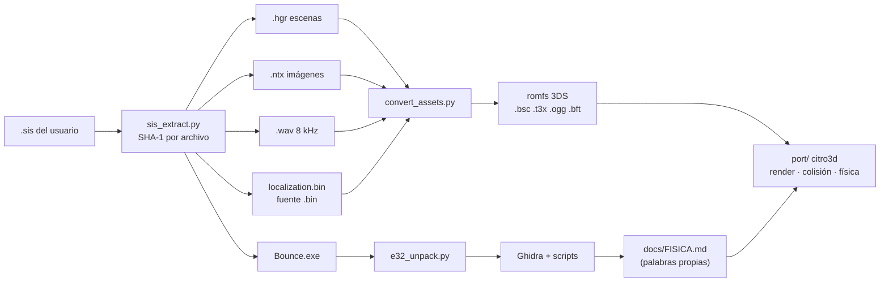
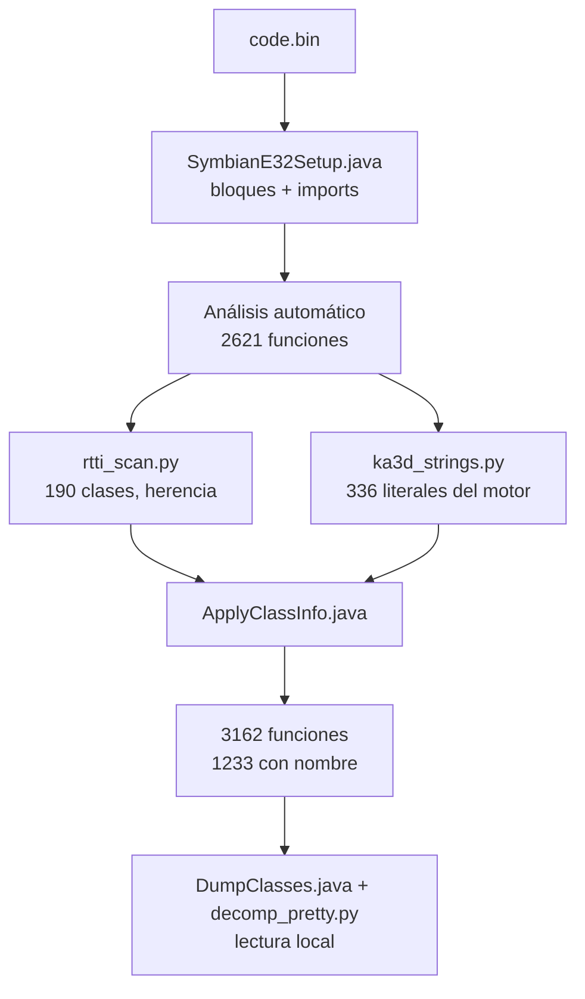

# Guía de un port nativo: de un juego de Symbian a la 3DS

Cómo se llevó **Bounce Touch** (Rovio, 2009, Nokia S60v5) a la Nintendo 3DS como port nativo, al estilo de Ship of Harkinian, re3 u OpenGOAL. Escrita para reutilizar el método en otros ports. Estado: hitos 1–5 de 6 (noviembre 2026).

## 1. Reglas del proyecto

- **El repositorio solo lleva código propio.** Ni assets, ni niveles, ni pseudocódigo decompilado. Cada usuario aporta su `.sis` y un script lo extrae y convierte en su equipo.
- **Ghidra sirve para entender, no para copiar.** Lo que se aprende se escribe con palabras propias (`docs/FISICA.md`) y se reimplementa desde ahí.
- **Nada de DRM.** La compresión BytePair del ejecutable es el formato estándar E32 de Symbian.
- **Pararse en cada hito** para que el dueño del proyecto lo revise.

## 2. El flujo completo

Dos caminos que solo se tocan a través de documentación: **datos** (se convierten) y **comportamiento** (se describe y se reescribe).

## 3. Hitos y lo que dio cada uno

| Hito | Resultado | Números |
|---|---|---|
| 1. Inventario | Mapa de formatos y de qué estaba documentado | 260 archivos, 8,2 MB; 157 `.ntx`, 77 `.wav`, 15 `.hgr` |
| 2. Ghidra | Ejecutable descomprimido; clases y funciones con nombre | 190 clases RTTI, 177 vtables, 1233 de 3162 funciones con nombre |
| 3. Formato `.hgr` | Especificación, lector, visor HTML, glTF y render PNG | 15/15 archivos leídos sin bytes sobrantes; 28 968 triángulos |
| 4. Conversión | Del `.sis` al romfs en un comando, reproducible | 256 archivos, 3,67 MB, 6,8 s |
| 5. Motor | Nivel, bola con física reimplementada, estéreo | 8 niveles, 60 FPS en Old 3DS real |
| 6. Juego completo | Pendiente | Triggers, acciones, menús, audio, `.cia` |

## 4. Técnicas reutilizables

### 4.1 Del ejecutable al proyecto de Ghidra

1. **Descomprimir el contenedor** (E32 BytePair: páginas de 4 KB con tabla de pares). Validar que el resultado es idéntico en dos máquinas (SHA-256).
2. **Resolver imports por ordinal** con los `.def` públicos del SDK. Los 539 imports quedan con nombre y demangle.
3. **Recuperar la RTTI de C++.** Cada `typeinfo` apunta a su nombre y a su clase base. Así sale el árbol completo de clases y, con las vtables, se nombran los métodos virtuales como `Clase::vNN`, atribuyendo cada uno a la clase que lo introduce.
4. **Cruzar cadenas con un motor abierto.** Si el juego usa un motor con código público (aquí KA3D), sus mensajes de error identifican funciones: `readPrimitive`, `Scene::Scene`, el lector de partículas…
5. **Hacer legible la coma flotante por software.** Un script cambia `__aeabi_fmul(a,b)` por `(a * b)` y las constantes `DAT_` por su valor. Sin esto la física no se lee.

### 4.2 Formatos de datos

- **Partir de un lector de referencia**, si existe, y **validar hasta el último byte**: si el archivo termina exactamente donde termina el lector, el formato está entendido. Los identificadores de control (`0x12345600 + n`) ayudan a encontrar desfases.
- **Comprobar los formatos de píxel a ojo**, con una imagen de color conocido. El enum público decía `A4B4G4R4`, pero la bola salía azul; con ARGB sale roja, como en el juego.
- **Detectar mezclas de endianness**: aquí los campos van en big-endian y los arrays de vértices, en little-endian.
- **Separar datos de lógica**: los niveles traen sus guiones como texto (`aNN = verbo,args`) y basta con extraer el vocabulario completo.

### 4.3 Conversión

- **Ida y vuelta**: cada `.bsc` generado se lee y se compara con el `.hgr` original antes de escribirlo.
- **Formatos pensados para la GPU de destino**: posiciones `int16` con escala y desplazamiento que aplica el shader del PICA200, y bloques de vértices listos para memoria lineal.
- **Salida reproducible**: un número de serie fijo en los `.ogg` hace que el romfs salga idéntico byte a byte en cada conversión.
- **Comprobar lo que el oído no ve**: la longitud de cada `.ogg` coincide muestra a muestra con su `.wav` (`granulepos`), para que los bucles de música enlacen.

### 4.4 Motor y pruebas

- **Banco de pruebas en el emulador**: un guion en la SD (`level`, `wait`, `hold UP+A 30`, `shot`, `log`), capturas a PNG y log con posición y velocidad. Se repite igual cada vez.
- **Render de referencia independiente** (Python, sin dependencias): con la misma cámara que la consola, demuestra si un fallo visual está en los datos o en el motor.
- **Probar en hardware pronto.** El emulador tolera cosas que el PICA200 real no.

## 5. Errores que cometimos (y cómo se detectaron)

| Error | Síntoma | Cómo se encontró |
|---|---|---|
| Orden de canales ARGB4444 tomado del enum público | Bola y logo azules | Mirar una imagen de color conocido |
| Visor HTML: añadir hijos durante `traverse()` | Todos los visores en blanco | Chrome headless con log de consola |
| Cámara del visor antes de `updateMatrixWorld` | Escena reducida a un punto | Captura de Chrome headless |
| Cabecera de 84 bytes documentada como 80 | No compilaba | `static_assert` en el código C |
| Stride de 12 bytes con 10 bytes de atributos | Pantalla negra en la consola real (Azahar lo aceptaba) | Diferencia emulador ↔ hardware |
| Giro de 3ds Max descartado en la raíz de la bola | Ojos encima de la bola | Cámara de depuración frente a la bola |
| `billboard = true` ignorado | Recogibles tumbados en el suelo | Inventario de propiedades |
| Restitución inventada (0,3) y umbral de más | La bola no rebotaba | El usuario jugando; luego el constructor de `Ball` dio 0,4 |
| `${VAR:+-a $VAR}` en zsh | 3dslink: «Invalid address» | Salida del comando |

Las tres lecciones que más se repiten: **no fiarse de la documentación sin probarla**, **probar cada salida en su destino real** y **poner en el código aserciones que comprueben los formatos**.

## 6. Física reimplementada (resumen)

| Parámetro | Valor | Dónde salió |
|---|---|---|
| Gravedad | (0, −2000, 0) u/s² | Inicialización global |
| Masa / radio | 1,0 / 55 | Constructores de `ActiveGameObject` y `Ball` |
| Restitución | 0,4 × \|n.y\| | Constructor de `Ball` y respuesta al choque |
| Impulso de control | 1750 × (1,4 suelo / 0,25 aire) × dt | Tabla constante y `Game::v03` |
| Límite por forma | 800 / 1500 / 800 u/s | Tabla constante |
| Salto (forma normal) | 1300 hacia `(0, 4,2·(0,25+0,75k), 0) + delante·k` | Función de salto |
| Velocidad máxima | 2000 u/s | Constructor de `PlayerBall` |
| Rozamiento | 100 u/s² × cos(pendiente) | Respuesta al choque |

Detalle completo en `docs/FISICA.md`.

## 7. Herramientas del proyecto

| Herramienta | Para qué |
|---|---|
| `tools/sis_extract.py` | Extraer un `.sis` de Symbian 9 y verificar cada archivo |
| `tools/e32_unpack.py`, `make_import_map.py` | Descomprimir el ejecutable y resolver imports |
| `tools/rtti_scan.py`, `ka3d_strings.py`, `ghidra/*.java` | Clases, vtables y nombres en Ghidra |
| `tools/decomp_pretty.py` | Leer pseudocódigo con coma flotante por software |
| `tools/hgr.py`, `ntx.py`, `hgr_export.py` | Leer, ver y exportar escenas e imágenes |
| `tools/bsc.py`, `convert_assets.py` | Formato de la 3DS y conversión completa |
| `port/build.sh`, `port/tools/emu_test.sh` | Compilar, enviar por 3dslink y probar en Azahar |

## 8. Lo que falta

1. Cámara que no atraviese el escenario (rayo contra la colisión) y, después, la del original.
2. Triggers y los 48 verbos de acción; objetos que se mueven y animaciones.
3. Formas roca y barro y grupos de colisión.
4. Control táctil como el original.
5. Diálogos, HUD, menús, guardado, audio y `.cia`.
6. Crear el repositorio, solo con código propio.
