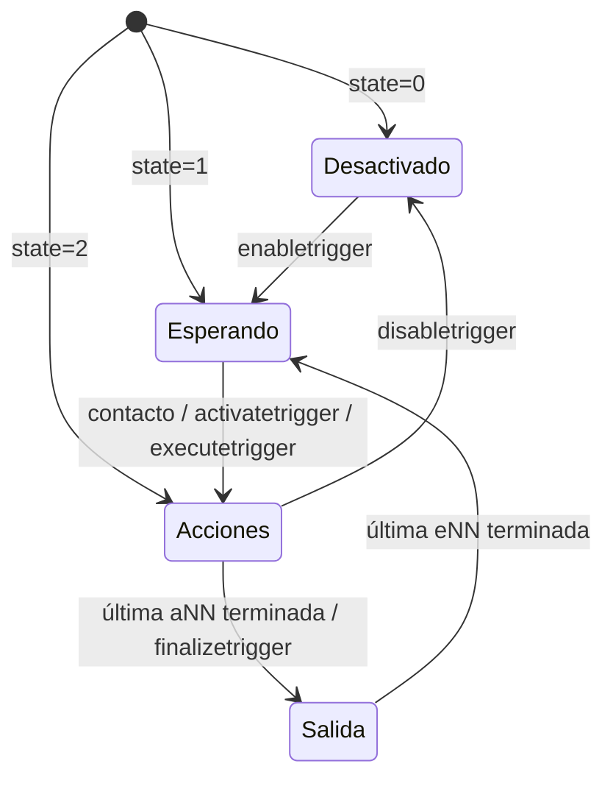

# Guiones de nivel: comportamiento observado

Cómo interpreta el juego las propiedades de usuario de los `.hgr` (ver `HGR.md` §7). Descripción propia a partir de Ghidra:
- **Tabla de verbos:** `0x166AD0`, 61 entradas.
- **Fábrica de acciones:** `FUN_00013784`.
- **Ejecutor:** `FUN_000115d4`.
- **Clase `Trigger`:** `v02` es el avance por fotograma y `v05` la activación.

La reimplementación está en `port/source/script.cpp`. «(port)» marca decisiones propias donde el binario no se ha leído del todo.

## Trigger

Cualquier nodo con acciones `aNN` y/o `eNN`. Propiedades:

| Propiedad | Efecto |
|---|---|
| `state` | Estado inicial: `0` desactivado, `1` esperando (por defecto), `2` empieza a ejecutar al cargar el nivel |
| `collisiontype` | `OBB` (caja del dummy) o `SPHERE`: volumen que lo dispara al tocarlo la bola |
| `executetype` | `0`: se ejecuta una sola vez (escenas, palancas); sin él, se repite cada vez que se dispara (`T_fail`) |
| `activatetype` | `1`: salta cuando la bola sale del volumen (cajas `T_universal_death` que envuelven el nivel) |
| `activatorid` | Solo lo activa un objeto con ese id (port: se ignora; solo hay una bola) |
| `executetrigger = T_x` | En una malla de colisión: tocarla dispara `T_x` |

**Máquina de estados** (campo `+0x118`):

En cada fotograma, el estado 2 ejecuta la acción actual: si termina, pasa a la siguiente en el mismo fotograma; si espera (`delay`, un movimiento con espera…), se queda. Los movimientos sin espera siguen en una lista aparte.

## Verbos

Índices de acción en base 1 (`a01` = 1). Coordenadas y desplazamientos escritos como en 3ds Max (Z arriba): el vector `(x, y, z)` se aplica en los ejes locales del nodo como `(x, y, −z)`, que en mundo equivale a `(x, z, y)` para un nodo sin giro.

| Verbo | Argumentos | Efecto |
|---|---|---|
| `delay` | `s[,s2]` | Espera `s` segundos (port: con `s2`, un valor al azar entre ambos) |
| `randomdelay` | `a,b` | Espera un tiempo al azar entre `a` y `b` |
| `nop` | – | Nada |
| `jumptoaction` | `n[,veces]` | Salta a la acción `n`; con `veces`, repite ese número de veces y después sigue |
| `jumptorandomaction` | `n1,…` | Salta a una de las acciones indicadas |
| `activatetrigger` | `T[,this]` | Pone el trigger en ejecución desde `a01` (`this`: dentro de la misma instancia de librería) |
| `activaterandomtrigger` | `T1,T2,…` | Activa uno al azar |
| `enabletrigger` / `disabletrigger` / `pausetrigger` | `T[,this]` | Desactivado → esperando / → desactivado / → desactivado sin reiniciar |
| `finalizetrigger` | `T` | Salta a sus acciones de salida |
| `set` · `add` · `sub` · `mul` · `div` | `var,valor` | Variables numéricas; `valor` puede ser otra variable |
| `less` · `equal` · `greater` · `notequal` | `var,valor[,n]` | Si se cumple, sigue; si no, salta a `n` (port: sin `n`, repite la comprobación) y espera al fotograma siguiente |
| `link` | `padre,hijo…` | Engancha nodos al padre (`scene` = raíz): se ven y colisionan |
| `unlink` | `nodo…` | Los desengancha: dejan de verse y de colisionar |
| `moveobject` | `obj,nodo,dx,dy,dz,s[,espera[,ejes]]` | Desplaza `nodo` (dentro de `obj`) en `s` segundos. `espera = 1`: la acción no termina hasta acabar. `ejes = 1`: el vector se toma tal cual en el mundo |
| `rotateobject` | `obj,nodo,rx,ry,rz,s[,espera[,ejes]]` | Igual, girando (grados). Al ser un vector axial, la reflexión de Z cambia su sentido: en ejes locales del nodo es `(−rx, −ry, rz)` |
| `moveuv` | `obj,nodo,du,dv,s[,…]` | Desplaza las UV de una malla (agua, cintas) |
| `setobjectpos` | `obj,dummy[,orient]` | Lleva el objeto al dummy (`G_balls_root` = la bola) |
| `setrenderstate` | `obj,nodo,0/1` | Oculta o muestra un nodo; en una malla de colisión, la apaga o la enciende. `CO_nombre` = la colisión del nodo `nombre` |
| `switchrenderstate` | `obj,nodo` | Muestra `nodo` y oculta sus hermanos de la misma serie (fotogramas: `duckeye01…04`) (port) |
| `playanimation` | `nodo,obj,anim,ini,fin[,bucle,…]` | Reproduce la animación de transformación entre dos fotogramas |
| `checkpoint` | `D_x[,0]` o `x,y,z,ángulo` | Punto de reaparición |
| `levelfailed` · `levelcomplete` | – | Perder una vida y reaparecer · completar el nivel |
| `setgamemode` | `n` | `0` juego normal; `3` escena: sin control y la bola quieta (port: deducido de la intro del nivel 1, donde la bola espera sobre `D_start`); otros modos sin leer |
| `setguidingobject` | `obj` | La cámara usa los nodos `cameraposition` y `cameralookat` de `obj` |
| `setcameraview` | `inclinación,distancia` | Cámara de juego (por defecto 55° y 555) |
| `setcamprops` | `a,b[,rigidez,amortiguación]` | `a = 1`: la cámara sigue a la bola; `a = 0`: usa el objeto guía. `b` sin leer. Muelle por defecto 27,5 y 5,5 |
| `speedmul` | `obj,f` | Multiplica la velocidad de la bola |
| `addimpulse` | `fuerza,D_x` | Impulso a la bola en la dirección del dummy |
| `maxspeed` | `v` | Velocidad máxima de la bola |
| `setballdirection` | `ángulo` | Orientación de la bola |
| `showtext` | `CLAVE` | Muestra un texto de `localization.bin` |
| `playsound` · `stopsound` · `particlefx` | … | Sonido y partículas (pendiente en el port) |
| `pressure` · `counter` · `waitforidle` · `waitforkey*` | … | Tutoriales y casos especiales (port: aproximados) |

## Valores por defecto (tabla `0x166A78`)

| Valor | Uso |
|---|---|
| 55 | Inclinación de la cámara (°) |
| 555 | Distancia de la cámara |
| 27,5 / 5,5 | Rigidez / amortiguación del muelle de la cámara |
| 800 / 1500 / 800 | Límite de velocidad por forma |
| 2000 | Velocidad máxima |
| 1750 | Impulso de control |

## Reglas del motor y su evidencia

Regla de trabajo: ninguna regla cambia sin evidencia del binario. Cada una lleva en el código (`port/source/rules.h` y los archivos que la usan) la dirección de origen; si es lógica pura, también un test diferencial (`tests/`). Antes de reimplementar un método, `docs/CLASES.md` dice qué versión se ejecuta.

**Estados:**
- **V-test**: leída y comprobada con test diferencial contra el original en Unicorn.
- **V-lectura**: leída en el binario, sin test diferencial todavía.
- **V-traza**: medida en el juego original corriendo en EKA2L1 (`tools/eka2l1/`, trazas locales en `re/traces/`).
- **Pendiente**: deducción mía sin evidencia suficiente; hay que leerla.
- **Port**: invención del port que no existe en el original o no se puede verificar así.

### Física de la bola (prioridad 1)

| Regla | Estado | Origen / evidencia | Nota |
|---|---|---|---|
| Restitución 0,1 solo con bit 15 de `group`; si no, 0,001 | V-traza | `PlayerBall::v05` 0x4f2c8; traza EKA2L1: 14 impactos bit 15 → 0,1000, 9 sin él → 0,0010 | El constructor pone 0,4; quién escribe el 0,1 está **pendiente** de localizar |
| Bits de `group` → campos `+0x148…+0x159` | V-traza | `FUN_00021fe8` 0x21fe8; en ejecución `bouncecol` (49936) da `+0x148`=0, `+0x14c`=1, `+0x150..0x159`=1100001100 | Falta usar: superficie mortal (bit 12), modo (bits 0–3), sin aplastamiento (bit 11) |
| Reflejo `v_t − e·v_n` | V-test | `FUN_0014a2fc` 0x14a2fc | `tests/test_rules_diff.py` |
| Respuesta completa al contacto (elección del contacto, velocidad relativa a la superficie, corrección de posición, rozamiento con `this[0x53]`, normal suavizada `this[0x74]`) | Pendiente | `PlayerBall::v05` 0x4f2c8 | El port usa una versión simplificada; siguiente test diferencial |
| Rozamiento: fuerza F = −v̂·min(μ·m·N, m·\|v\|/dt), N = −g·n, μ = 0,225, aplicada en el cuadro siguiente | V-traza parcial | `PlayerBall::v05` 0x4f2c8 (`this[0x41]` masa, `this[0x53]` coeficiente); traza: \|F\| = 450·n.y en 3654 contactos (error mediano 0,8 %), siempre contra v | El término de tope (bola casi parada) se desvía ~2 % de la traza: **pendiente** |
| Integración `v += F/m·dt + J/m` | Pendiente | `ActiveGameObject::v03` 0x182d8, pero `PlayerBall` sobrescribe la entrada 3 (0x4ee68) | Hay que leer `PlayerBall::v03` |
| Gravedad (0, −2000, 0) | V-traza | `FUN_00034e6c`; traza: Δvy/dt = 2000,0 en 1217 pasos | |
| Masa 1 | V-lectura | `FUN_000181e8` (constructor de `ActiveGameObject`) | |
| Radio de colisión 50 | V-traza | `D_bounce radius=50`; traza: centro a 49,9–50,0 del suelo plano en reposo | Antes 55 (campo +0x138 del constructor, que no es el radio) |
| Control (impulsos 1750 × 1,4/0,25, giro 90/135 °/s) | V-lectura parcial | `Game::v03` 0x2e810 | Falta test diferencial |
| Salto (1300, frena al 20 %) | V-traza parcial | `FUN_00050d54` 0x50d54; traza: \|J\| = 1300,00 y dirección (y = 0,9728, horizontal 301) en 4 saltos a baja velocidad | Falta a velocidad alta |
| Velocidad máxima 2000 | V-lectura | `PlayerBall::v02` 0x4e808, constructor 0x4e6b4 | |
| Ignorar aristas internas si hay contacto de cara | Port | La detección de contactos original (`CollisionSpace`) no está leída | |
| Al empezar el nivel la bola aparece en `D_start` y cae | V-traza | Traza: cuadro 1 en `D_start` exacto, cae 260 u hasta `bouncecol` | Al **reaparecer** el port aún la apoya en el suelo (Port, sin traza) |
| La física de la bola corre en todos los modos (también en escenas, modo 3) | V-traza | `PlayerBall::v03` se ejecuta en 9930 de 9930 cuadros; la bola cae durante la intro | |
| En modo 3 no se aplica el control del jugador | Pendiente | El port lo ignora; sin verificar | |
| Entradas: teclas virtuales, «mantenida» en `global+0x214+código`, «pulsada» en `+0x278+código`; acciones 1..7 por tabla (`FUN_00020464`); salto = acción 5 pulsada o `+0x3f4` | V-lectura | `Game::v03` 0x2e810, `FUN_0005e960` | Se graban con `bt_trace_v2.lua` (líneas BTI) |

### Cámara (prioridad 2)

| Regla | Estado | Origen / evidencia | Nota |
|---|---|---|---|
| Valores por defecto: 55°, 555, muelle 27,5 / 5,5 | V-lectura | Tabla 0x166a78; `FUN_000115d4` casos 0x20/0x21 | Solo las constantes |
| Control táctil (`Game::v10` 0x2fd08; el de teclas es la otra rama, según `Game+0x158`): deslizar (>5) empuja en la dirección del gesto girada por la cámara, fuerza clamp(p2/p3, 600, 2000)·6,5 si la bola va por debajo de `+0x150`; mantener quieto (≥0,1 s, <15 px del toque) en el tercio izquierdo/derecho gira ∓90 °/s·1,2, en el centro frena con F −= 1200·v̂; tocar salta (`+0x3f4`) | V-lectura | Posición del dedo `g+0x3ec/0x3f0`, reloj `g+0x3cc`, toque inicial `Game+0x3c/0x40`, momento `Game+0x44`, última `Game+0x48/0x4c` | Implementado (`Game::touchControl`); verificado el deslizamiento (cuadro 1087: dirección exacta, 39,05 frente a 39,08). Ancho 640 por la traza (x de 13 a 639). Salto por toque: cuándo se activa `+0x3f4` **pendiente** (el port usa soltar en < 0,25 s) |
| Objetivo de la cámara: desplazamiento (0, 150, 0) sobre la bola; `setcameraview` en ejecución 55/555 (modo 2: 350/55) | V-traza | BTV de la sesión lenta | El port usa +40 |
| Restitución 0,4 → 0,1: se escribe tras el constructor de `PlayerBall` (`__cxa_vec_ctor` desde 0x4e710) y antes de la llamada a `PlayerBall::v17` desde 0x507fc | V-traza (acotado) | BTR de la sesión lenta | La función de 0x507fc no está decompilada; no se sigue (decisión del usuario) |
| Inclinación, rumbo y distancia de la cámara viven en la bola: `+0x138` (55, ±89), `+0x13c` (el giro suma 90/135 °/s × 1,2), `+0x140` (555, ±900/s) | V-lectura | Constructor `FUN_0001d97c`; `Game::v03` 0x2e810 | El 55 que el port tomaba por radio era la inclinación |
| Ojo deseado = bola + R_y(rumbo)·(0, sen(incl)·dist, −h), h = cos(incl)·dist·(1 − min(\|w224\|/800, 1)) si `+0x232`; con la animación de espera de la bola, 55°/350 | V-traza | `PlayerBall::v13` 0x14ea68; traza: error mediano 0,001–0,005 u por paso | Implementado (`Game::desiredView`) |
| Objetivo deseado = bola + (0, 150, 0); con la animación de espera, + (0, 75, 0) | V-traza | `PlayerBall::v12` 0x14ec50; `0x400150` = (0,150,0) en ejecución | Implementado |
| Muelle escalar del ojo: s += (k·exceso − c·s)·dt hacia el punto deseado, con zona muerta = h completo − h reducido (la escribe `PlayerBall::v02`); objetivo con el mismo muelle sin zona muerta | V-traza | `GameCamera::v02` 0x35470; cámara aislada (`bt_host --camara-aislada`): ojo 84,8 % y objetivo 99,3 % dentro de 5 u, error mediano 0,06 u | Implementado. Quedan 7 tramos (escenas, reaparición, ~0,25 s en el arranque de la espera) |
| Obstáculos: rayo del objetivo (−75 en Y) al ojo deseado; si choca, ojo en el choque + 35·normal; si queda a menos de 160 de la bola, a 160 en esa dirección | V-lectura, **desactivado** | `GameCamera::v04` 0x3504c (35, 75, 160) | En la traza no hubo ningún choque en 20260 cuadros aunque la bola se pegó a paredes: `FUN_00026640` prueba solo algunos objetos (¿`node03_cameracol`?). **Pendiente** de leer; el rayo del port está apagado |
| Fuente de la cámara: objeto guía (`setguidingobject`) en modo 3, la bola en los demás | V-traza | Sin excepción en 20260 cuadros | De la guía se usan `cameraposition`/`cameralookat`: **pendiente** de leer |
| `setcamprops a,b,k,c`: a/b encienden o apagan los muelles del ojo y del objetivo (−1 los deja); k/c ≥ 0 se usan, −1 los deja, otro negativo restaura 27,5/5,5 | V-lectura | Ejecutor `FUN_000115d4` caso 0x21 | Sustituye al `camFollow` deducido |
| Rumbo de la cámara: en modo 1 = atan2(vx, vz) si vx²+vz² > 60000; en modo 0 con `+0x232` = el de la cámara real del cuadro anterior; solo si la bola se mueve (`+0x231`: vx²+vz² > 15) y sin la acción 4 | V-traza | `PlayerBall::v02` 0x4e808; traza: 0,0003° y 0,0002° de error | Implementado (`Game::ballHeading`) |
| `+0x232` = \|w224\|² > 50000, con w224 = velocidad al entrar en la respuesta al choque; 6 cuadros sin contacto lo borran | V-traza | `PlayerBall::v05`/`v02`; 20260/20260 cuadros | Falta restar la velocidad de superficies móviles (pendiente: no hubo en la traza) |
| Modo de juego por la superficie tocada: bits 0–3 del grupo 0 → modo 0, 2 → modo 1, 3 → modo 2; no interrumpe los modos 3–5 (`setgamemode` sí) | V-lectura | `PlayerBall::v05`; `FUN_0002e29c` | Las carreteras (`road*_hidden`, grupo con bits 0–3 = 2) ponen el modo 1 |
| `waitforidle`: cuenta solo con > 0,25 s sin entradas y la bola quieta (`+0x231` = 0 y \|vy\| ≤ 50) | V-lectura | Ejecutor caso 0x38 | Antes contaba desde la última entrada (deducción) |
| Animación de espera de la bola (activa la cámara de espera) | V-traza parcial | `bounce.hgr`: `T_idlecontrol` (`waitforidle,5` → `T_B_idle`), `T_idleoff`; traza: empieza ~5,7 s tras el último toque y acaba al tocar | El port aún no ejecuta los guiones de `bounce.hgr`: se reproduce en `Game::Step` |
| Ángulo de visión de la cámara (55° en el port) | Pendiente | Sin verificar | |
| Acercar la cámara si choca con el escenario | Port | — | Puede no existir en el original |
| Cámara guiada si `setcamprops a = 0` o modo 3 | Pendiente | Deducida de la intro del nivel 1 | |

### Guiones (prioridad 3)

| Regla | Estado | Origen / evidencia | Nota |
|---|---|---|---|
| Vector de `moveobject`/`rotateobject` `(x, y, −z)` / `(x, z, y)` y ángulo `|v|·π/180` | V-lectura | `FUN_00013784` casos 0x15/0x1e; π en 0x1674a0 | |
| Aplicación por cuadro: matriz local actual, `local·R`, inversa del mundo con `ejes` | V-test (piezas) + test de geometría | `FUN_00039698` 0x39698; `FUN_0007adcc`, `FUN_0007af54`, `FUN_000738ec`, `FUN_00074054` | `tests/test_rules_diff.py`, `tests/test_tree_fall.py` |
| Velocidad del movimiento = cantidad / tiempo | V-lectura | `FUN_0003ae40` 0x3ae40 | |
| `moveuv` (signo × 4096 × velocidad × dt sobre las UV) | Pendiente | `FUN_00039698` tipo 2, `FUN_0003ae40` | El port desplaza la textura, no los vértices |
| Estados del trigger y avance de acciones | V-lectura | `Trigger::v02` 0x56f28 | |
| `executetype = 0`: solo una vez | Pendiente | Deducida (arregla la escena del topo); en `Trigger::v05` elige la lista de contactos | Hay que leer qué hace realmente |
| `activatetype = 1`: al salir del volumen | Pendiente | Deducida de `T_universal_death` | |
| Modo 3 = bola quieta | Pendiente | Deducida de la intro | |
| `CO_nombre` = colisión de `nombre` | Pendiente | Deducida (el nodo `CO_bouncecol` no existe) | |
| `switchrenderstate` muestra uno y oculta su serie | Pendiente | Deducida | |
| `delay a,b` al azar; comparaciones de 2 argumentos repiten; `counter` | Pendiente | Deducidas | |
| `addimpulse` en el eje Y del dummy | Pendiente | Deducida | |
| Teclas de `waitforkey*` | Pendiente | Deducidas; el original es táctil | |
| Coordenadas de `checkpoint x,y,z,a` como `(x, z, y)` | Pendiente | Deducida | |
| `playanimation`, `setballdirection`, sonido, partículas, formas | Sin implementar | | |
